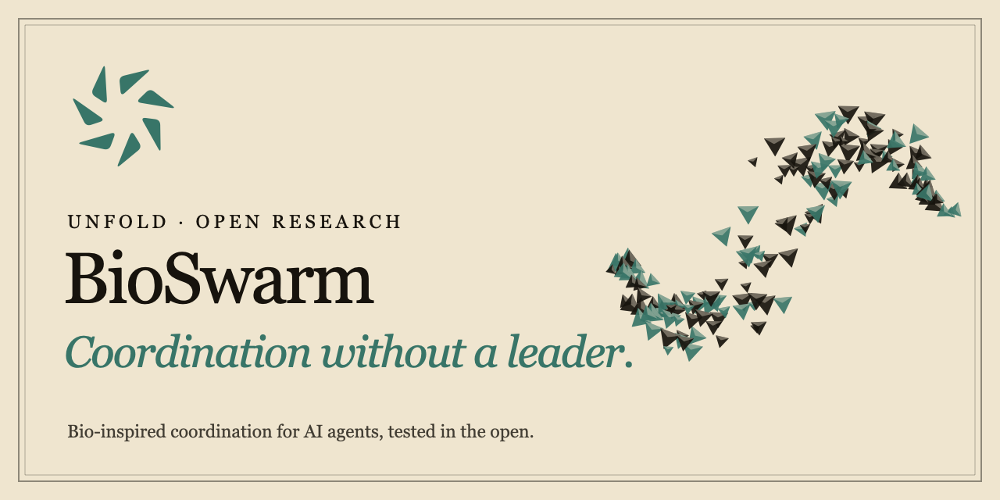
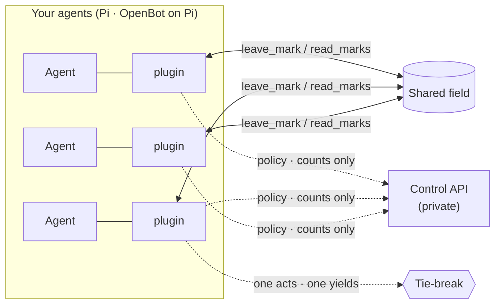

<p align="center">
  
</p>

<p align="center">
  <a href="LICENSE"></a>
  <a href="research/LICENSE"></a>
  <a href="research/hypotheses/README.md"></a>
  <a href="research/tasks"></a>
  <a href="protocol/bioswarm.v1.md"></a>
  <a href="https://github.com/unfold-research/bioswarm/actions/workflows/ci.yml"></a>
</p>

<p align="center">
  <a href="#how-bioswarm-works">How it works</a> ·
  <a href="#what-we-believe-now">What we believe now</a> ·
  <a href="#use-it">Use it</a> ·
  <a href="#reproduce">Reproduce</a> ·
  <a href="#contributing">Contribute</a> ·
  <a href="https://unfold.host/research/">Lab notebook ↗</a>
</p>

# BioSwarm

**Bio-inspired coordination for teams of AI agents, and the open research behind it.**

BioSwarm is the coordination engine at the core of [Colony](https://unfold.host/colony/), built by
[Unfold](https://unfold.host), a swarm research lab. This repository is where the whole project lives in the open: the
research question, every hypothesis, preregistration, study report and independent review, failures included, plus the
protocol, the SDK and the benchmark harness. The plugin that runs inside agent hosts lives in
[**bioswarm-plugin**](https://github.com/unfold-research/bioswarm-plugin).

> [!IMPORTANT]
> **The question.** Do *N* agents coordinated by mechanisms from nature beat *N* agents coordinated the way the market
> does it (a manager agent, or a group chat) on work that needs *N* agents?
>
> We do not know yet. No proven advantage of any swarm over a single agent or a manager agent is claimed. What follows
> is everything we have measured so far, with its limits.

## At a glance

| | |
|---|---|
| **224** hypotheses | 73 supported · 44 refuted · 53 inconclusive · 11 testing · 43 open ([index](research/hypotheses/README.md)) |
| **127** preregistrations | seeds, stopping rules and a matched conventional baseline, frozen before any paid run ([tasks/](research/tasks)) |
| **140** study reports | results as they came out, including the ones that refuted us ([results/](research/results)) |
| **48** independent reviews | each by a model from another family than the one under test ([docs/reviews/](research/docs/reviews)) |
| **53** natural mechanisms | written up as engineering candidates, from ant trails to lateral inhibition ([research/nature/](research/research/nature)) |
| **10** deterministic simulations | free to rerun, 46 predictions checked against their cards ([sims/](research/sims)) |

## How BioSwarm works

Biology applied to engineering. A mechanism from nature goes in only where it earns its place in the work, never as
decoration. BioSwarm has four parts:



| Part | What it does | Where |
|---|---|---|
| **Open plugin** | connects the agents to the engine and enforces the rules in code, inside the agent loop | [bioswarm-plugin](https://github.com/unfold-research/bioswarm-plugin) |
| **Shared field** | agents leave marks of what they are doing and what they have done, the way ants leave trails; the others read the marks instead of messaging all the time | plugin · [protocol](protocol/bioswarm.v1.md) |
| **Tie-break** | when two agents reach for the same spot, one acts and the other yields, without blocking anyone | plugin · [waves](https://github.com/unfold-research/bioswarm-plugin/blob/main/docs/WAVES.md) |
| **Control API** | private service that chooses and tunes the strategy each team runs and keeps the metrics; without a key the plugin runs the open community policy | [protocol](protocol/bioswarm.v1.md) · [SDK](packages/sdk) |

Each rule traces back to a study:

| In nature | In BioSwarm | Evidence |
|---|---|---|
| Stigmergy: ants coordinate through traces left in the environment | shared field of typed marks; message ceilings | [beliefs 1, 9](research/FINDINGS.md), [harness studies](research/results/harness-study-2026-11/REPORT.md) |
| Lateral inhibition: one side holds the turn | hash tie-break on contested checks | [beliefs 2, 12](research/FINDINGS.md) |
| Signal, not symptom: act when the requirement arrives | addressed requirement trace (experimental, off by default) | [beliefs 5, 7, 10](research/FINDINGS.md) |

## What we believe now

A one-page summary of [`research/FINDINGS.md`](research/FINDINGS.md) (2026-11-25), which holds the evidence and, for
every row, *what would change it*. Preliminary: synthetic code tasks, one model family for everything except the
latency result at 160 modules (belief 7), which holds on two families with one model each.

| # | Belief | Confidence |
|---|---|---|
| 1 | Leaderless conversation cannot coordinate coupled work. | High |
| 2 | Any arbiter cures that oscillation. | High |
| 3 | The geometry of a conflict decides the protocol. | Medium |
| 4 | With one check for feedback and scoring, the bio router finishes as often as a manager agent. | Medium |
| 5 | The first bio mechanism that matches the manager without help: agents carry the requirement as traces on the check, and the owner of the source acts only once the trace arrives. | Medium |
| 6 | Up to 80 modules, one agent with every specification is still as good as any team. | Medium |
| 7 | Where bio should win is not small exact tasks but scale, latency, loss of members and open-ended work. Latency is shown for one setting; the rest is not yet shown. | Medium for latency at 160 modules; not tested for the rest |
| 8 | Passing the tests is not solving the task. | High |
| 9 | In the Colony with real agents, the default team stalls when its message budget between ants runs out. | Low |
| 10 | Waiting for the trace holds on fresh inputs; the router does not. | Medium |
| 11 | The manager's losses under an equal wave budget are a design result, not evidence that it coordinates worse. | Medium |
| 12 | On format pairs, symmetry breaking is necessary, for the bio arm as much as for anyone. | High (necessary) |
| 13 | In this instrument a trace's author corrects it on its own when the requirement changes. | Structural |
| C1–C3 | Cyber: a simple swarm-style clearance rule defends CC4 well; an LLM team told the rule still does worse than the rule as code; three swarm-defence traits add nothing over it. | Medium |
| G1 | Genome: notes kept from a related case make the first attempt on the next one slightly better, but not faster or cheaper. | Low to medium |

> [!WARNING]
> **The field tests did not favour the trace rules.** The beliefs above come from synthetic tasks. In BioSwarm's two
> field tests on a simulated multichannel retail close, the arm with addressed traces and tie-break finished later than
> the shared field alone (4 of 6 pairs in phase 1b, 4 of 4 in phase 1b-r) and was not cheaper; quality was
> inconclusive. Internal reports, not independently reviewed: [phase 1b](results/phase1b/REPORT.md) ·
> [phase 1b-r](results/phase1b-r/REPORT.md). That is why the recommended policy is the shared field with the hash
> tie-break, and waiting for a trace stays experimental.

## Use it

**Run the rules in your agents** with the plugin (Pi, or OpenBot agents on the Pi provider):

```sh
npm install -g github:unfold-research/bioswarm-plugin
bioswarm-pi install && bioswarm-pi on path/to/agent-folder
```

**Drive coordination remotely** with the SDK (needs a BioSwarm Control API key; the API is in internal testing):

```js
import { BioSwarm } from '@unfold/bioswarm';

const bs = new BioSwarm({ apiKey: process.env.BIOSWARM_API_KEY });
await bs.policies.assign({ strategy: 'field-tiebreak' });
const run = await bs.runs.create({ goal: 'Fix the failing build', agents: ['lead', 'dev-1', 'dev-2'], budgetUsd: 5 });
console.log(await bs.metrics.summary({ run: run.id }));
```

> [!NOTE]
> Pre-release. BioSwarm and Colony are in internal testing; the packages are not on npm yet. Install from GitHub.

## Reproduce

Everything below is free and deterministic: no API key, no model calls.

```sh
git clone --recurse-submodules https://github.com/unfold-research/bioswarm
cd bioswarm && npm ci

npm test                                          # SDK and plugin suites
node --test bench/*.test.mjs                      # benchmark harness

cd research
node sims/run-all.mjs                             # all simulations; numbers and verdicts match the cards
node --test research/theory/model.test.mjs        # theory checks
(cd allocator && node --test)                     # budget allocator from LAB-006
node scripts/verdicts.mjs                         # LI hypothesis pages match results/li-verdicts.json
node scripts/hypotheses-index.mjs --check         # hypotheses/README.md is current
```

Paid studies call real models. Their preregistrations name the model, seeds, arms and stopping rules; their reports
link the code that ran. Raw model replies are not in the repository; manifests with SHA-256 digests are, so a future
release of the raw data can be checked against them.

## How we work

- **Nature proposes, experiments decide.** Every card carries one evidence level: natural phenomenon (an analogy, not
  proof), author-reported, observed implementation, hypothesis, local validation, or gap. A simulation result is
  support inside a model, never a claim about LLMs.
- **Preregister, then run.** Hypotheses, arms, seeds, stopping rules and analysis are frozen before a paid run, and the
  conventional baseline gets the same budget.
- **Review across families.** Studies are reviewed by a model from another family than the one under test, and the reviews are published next to the reports.
- **Publish what fails.** Refuted and inconclusive results stay in the record with the supported ones. The
  [lab notebook](https://unfold.host/research/) has a section called *What we got wrong*.

## Repository map

| Path | What is there |
|---|---|
| [`research/`](research) | the lab: findings, hypotheses, preregistrations, reports, reviews, natural mechanisms, simulations, study code ([guide](research/README.md)) |
| [`protocol/`](protocol) | `bioswarm.v1`, the contract between the plugin, the SDK and the Control API |
| [`packages/sdk`](packages/sdk) | `@unfold/bioswarm`, the SDK for the Control API |
| [`packages/connector-pi`](https://github.com/unfold-research/bioswarm-plugin) | the plugin, as a git submodule of [bioswarm-plugin](https://github.com/unfold-research/bioswarm-plugin) |
| [`bench/`](bench), [`results/`](results) | the BioSwarm field studies (phase 1, 1b, 1b-r): harness, preregistrations and reports (in Portuguese) |
| [`docker/`](docker), [`scripts/`](scripts) | host contract smoke tests, compatibility and report scripts |
| [`docs/`](docs) | versioning and lifecycle |

### What is not here

- **Raw model replies** and per-call logs: only manifests and digests.
- **Budgets and spending.** Dollar amounts from our runs are redacted as `[US$ redacted]` and cost fields are removed from
  the JSON. Relative results (ratios, tokens, waves) stay, because they are measured outcomes.
- **Internal case studies, operations and team notes.** References to `internal/`, `STATE.md` or ledgers point to
  material that stays private.
- **The Control API.** It is Unfold's private service; its contract is public in [`protocol/`](protocol).

## Contributing

Open research is better with more eyes. Good ways in:

- **Challenge a belief.** Every row of [FINDINGS](research/FINDINGS.md) says what would change it. Open an issue with
  the evidence, or propose a study.
- **Replicate a study** from its preregistration, on another model family if you can.
- **Propose a natural mechanism** with the evidence level it has today ([map](research/research/nature/MAP.md)).
- **Improve the plugin or the SDK** with a pull request in the right repository.

Read [CONTRIBUTING.md](CONTRIBUTING.md) first. Please report vulnerabilities privately as described in
[SECURITY](https://github.com/unfold-research/.github/blob/main/SECURITY.md).

## Citing

If you use the research, cite it as described in [CITATION.cff](CITATION.cff) (GitHub shows a *Cite this repository*
button). Name the study and the commit you used: findings change as studies come in.

## License

Code is licensed under [Apache-2.0](LICENSE). Research content (text, figures and data in [`research/`](research) and
[`results/`](results)) is licensed under [CC BY 4.0](research/LICENSE).

<p align="center"><sub>BioSwarm is made by <a href="https://unfold.host">Unfold</a>, in Brazil. <a href="https://unfold.host/research/">Lab notebook</a> · <a href="https://unfold.host/colony/">Colony</a> · <a href="https://github.com/unfold-research/bioswarm-plugin">Plugin</a></sub></p>
